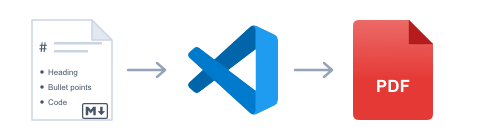
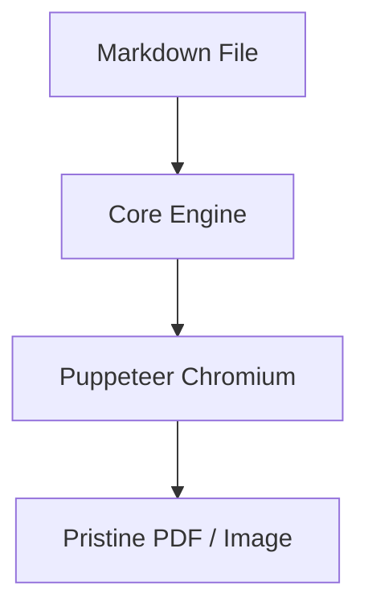

# Markdown PDF CLI

<p align="center">
  
</p>

<p align="center">
  <b>Standalone Command Line Interface (CLI) for Markdown PDF</b><br>
  Convert Markdown files to PDF, HTML, PNG, and JPEG directly from your terminal or CI/CD pipelines — completely independent of VS Code.
</p>

<p align="center">
  <a href="#quick-start">Quick Start</a> •
  <a href="#installation">Installation</a> •
  <a href="#cli-options-reference">CLI Reference</a> •
  <a href="#configuration">Configuration</a> •
  <a href="#advanced-features">Advanced Features</a> •
  <a href="#panduan-bahasa-indonesia">Panduan Bahasa Indonesia</a> •
  <a href="#credits--acknowledgments">Credits</a>
</p>

---

## Overview

**Markdown PDF CLI** brings the full rendering power of the popular [vscode-markdown-pdf](https://github.com/yzane/vscode-markdown-pdf) extension by **yzane** into an autonomous, high-performance Node.js CLI tool.

- **Zero VS Code Dependency**: Runs standalone in Node.js on macOS, Linux, and Windows.
- **Identical 100% Rendering Parity**: Exact same engine, CSS styles, and output as the VS Code extension.
- **Rich Diagram & Math Support**: First-class rendering for **Mermaid**, **PlantUML**, and **KaTeX** math equations.
- **Multi-Format Export**: Convert to `PDF`, `HTML`, `PNG`, and `JPEG` in a single command.
- **Automation Ready**: Perfect for GitHub Actions, GitLab CI/CD, Git hooks, documentation generators, and automated reporting.

---

## Installation

### Option 1: Global Installation via npm

Install globally from the repository:

```bash
# From within the repository directory
npm install -g .

# Or link locally for development
npm link
```

Verify your installation:

```bash
markdown-pdf --version
# Output: 2.2.0

markdown-pdf --help
```

### Option 2: Run Directly with npx or Node

You can run the CLI without installing it globally:

```bash
# Using npx (from repository or published package)
npx markdown-pdf document.md

# Directly executing the built binary
node dist/cli.js document.md
```

---

## Quick Start

### 1. Standard Conversion to PDF

Convert a markdown file to PDF (saved as `document.pdf` in the same directory):

```bash
markdown-pdf document.md
```

### 2. Convert to All Formats (PDF, HTML, PNG, JPEG)

Export all 4 formats at once:

```bash
markdown-pdf -t all document.md
```

Or specify individual formats:

```bash
markdown-pdf -t pdf,html document.md
```

### 3. Batch Conversion to an Output Directory

Convert multiple markdown files using glob patterns and write results into `./dist/`:

```bash
markdown-pdf -t pdf -o ./dist/ docs/*.md
```

### 4. Custom Stylesheet & Landscape Orientation

Apply your own custom CSS styling and render in landscape orientation:

```bash
markdown-pdf -s custom.css --landscape document.md
```

### 5. Paper Format & Margins

Customize paper format (`Letter`, `Legal`, `A3`, `A4`, etc.) and margins:

```bash
markdown-pdf --format Letter --margin 15mm document.md
```

Individual margins:

```bash
markdown-pdf --format A4 --margin-top 20mm --margin-bottom 20mm --margin-left 15mm --margin-right 15mm document.md
```

---

## CLI Options Reference

| Option | Shorthand | Type / Values | Default | Description |
| :--- | :--- | :--- | :--- | :--- |
| `--version` | `-v` | Flag | | Output the current version number. |
| `--help` | `-h` | Flag | | Display comprehensive help and exit. |
| `--type <types...>` | `-t` | `pdf`, `html`, `png`, `jpeg`, `all` | `pdf` | Output format(s). Can be comma-separated or space-separated. |
| `--output <path>` | `-o` | File or Directory path | `[source-dir]` | Destination output file path (single file) or directory (multiple files/types). |
| `--style <paths...>` | `-s` | Path(s) to `.css` files | `[]` | Additional custom CSS stylesheets. |
| `--format <format>` | | `A4`, `Letter`, `Legal`, `Tabloid`, `A3`, `A5` | `A4` | PDF paper format. |
| `--landscape` | | Flag | `false` | Render PDF in landscape orientation. |
| `--margin <margin>` | | CSS length (e.g. `15mm`, `1cm`, `0.5in`) | | Set uniform margins for all four sides. |
| `--margin-top <margin>` | | CSS length | `1cm` | Set top page margin. |
| `--margin-bottom <margin>` | | CSS length | `1cm` | Set bottom page margin. |
| `--margin-left <margin>` | | CSS length | `1cm` | Set left page margin. |
| `--margin-right <margin>` | | CSS length | `1cm` | Set right page margin. |
| `--highlight-style <name>` | | Theme name (e.g. `github.css`, `monokai.css`) | `github.css` | Syntax highlight theme for code blocks. |
| `--no-highlight` | | Flag | `false` | Disable syntax highlighting on code blocks. |
| `--mermaid-server <url>` | | URL string | unpkg CDN | URL to custom `mermaid.min.js` script. |
| `--plantuml-server <url>` | | URL string | PlantUML official | URL for PlantUML diagram rendering server. |
| `--executable-path <path>` | | Path | Auto-detect | Path to custom Chromium/Chrome/Edge executable. |
| `--no-auto-download` | | Flag | `false` | Disables automatic download of Chromium if no browser is found. |
| `--config <path>` | `-c` | Path to JSON/YAML file | | Load settings from an external configuration file. |
| `--debug` | | Flag | `false` | Preserve temporary HTML files and show verbose debug output. |
| `--quiet` | `-q` | Flag | `false` | Suppress all terminal output except errors. |
| `--scale <scale>` | | Float number (`0.1` to `2.0`) | `1` | Zoom/scale factor for page rendering. |
| `--width <width>` | | CSS length (e.g. `210mm`, `8.5in`) | | Custom paper width (overrides `--format`). |
| `--height <height>` | | CSS length (e.g. `297mm`, `11in`) | | Custom paper height (overrides `--format`). |
| `--page-ranges <ranges>` | | Range string (e.g. `"1-5, 8"`) | All | Specific page ranges to include in output PDF. |
| `--sanitize <mode>` | | `gfm`, `gfm-allow-style`, `none` | `gfm` | HTML sanitization security mode. |
| `--breaks` | | Flag | `false` | Convert soft line breaks in Markdown to `<br>`. |
| `--no-header-footer` | | Flag | `false` | Disable both header and footer in PDF export. |
| `--header-template <html-tpl>` | | HTML string | Title & Date | Custom HTML template for PDF header (`<span></span>` to leave header blank). |
| `--footer-template <html-tpl>` | | HTML string | Page number | Custom HTML template for PDF footer (e.g. `<span class="pageNumber"></span>`). |

---

## Configuration & Hierarchy

Markdown PDF CLI resolves settings through a clear 4-tier hierarchy. Each tier overrides the one before it:

```
[1. Default Configuration]
         ↓
[2. External Config File (--config)]
         ↓
[3. Document YAML Front Matter]
         ↓
[4. CLI Command Line Flags] (Highest Precedence)
```

### 1. Document YAML Front Matter

You can embed configuration directly at the top of your `.md` file using YAML front matter. CLI options will still take precedence over these values:

```markdown
---
format: Letter
orientation: landscape
margin:
  top: 15mm
  bottom: 15mm
  left: 20mm
  right: 20mm
styles:
  - ./styles/custom.css
highlightStyle: monokai.css
breaks: true
plantumlServer: http://www.plantuml.com/plantuml
---

# Document Title

Your markdown content here...
```

### 2. External Configuration File (`--config`)

Store your organization's standard settings in a `.json` or `.yaml` file:

**`markdown-pdf.json`**:
```json
{
  "format": "A4",
  "orientation": "portrait",
  "margin": {
    "top": "1.5cm",
    "bottom": "1.5cm",
    "left": "1.2cm",
    "right": "1.2cm"
  },
  "highlight": true,
  "highlightStyle": "github.css",
  "styles": ["./styles/corporate.css"],
  "sanitize": "gfm"
}
```

**`markdown-pdf.yaml`**:
```yaml
format: A4
orientation: portrait
margin:
  top: 1.5cm
  bottom: 1.5cm
  left: 1.2cm
  right: 1.2cm
highlightStyle: github.css
styles:
  - ./styles/corporate.css
sanitize: gfm
```

Execute with the config flag:

```bash
markdown-pdf --config markdown-pdf.yaml document.md
```

*(Note: Scoped configurations under `"markdown-pdf"` or `"markdown_pdf"` keys are also automatically detected and unpacked).*

---

## Advanced Features

### 1. Mermaid Diagrams

Markdown PDF natively converts fenced Mermaid code blocks into SVG diagrams:

````markdown

````

**How It Works:**
1. The Markdown parser transforms ` ```mermaid ` code blocks into `<div class="mermaid">...</div>` containers.
2. The HTML builder injects the Mermaid rendering script from the configured `mermaidServer`.
3. In Puppeteer headless Chromium, page navigation waits for `networkidle0`. This guarantees that Mermaid completely hydrates, executes client-side scripts, and compiles all diagrams into crisp SVGs before Chromium captures the PDF or screenshot.

Supported diagram types include:
- Flowcharts (`flowchart TD`, `graph LR`)
- Sequence Diagrams (`sequenceDiagram`)
- Class Diagrams (`classDiagram`)
- State Diagrams (`stateDiagram-v2`)
- Entity Relationship Diagrams (`erDiagram`)
- Gantt Charts (`gantt`)
- Git Graphs (`gitGraph`)
- Pie Charts (`pie`)

### 2. KaTeX Mathematics

Write clean, beautiful mathematical formulas with KaTeX:

- **Inline formulas**: `$E = mc^2$` or `\(a^2 + b^2 = c^2\)`
- **Block equations**:
  ```markdown
  $$
  \int_{-\infty}^{\infty} e^{-x^2} \, dx = \sqrt{\pi}
  $$
  ```
- **LaTeX bracket syntax**:
  ```markdown
  \[
  \sum_{k=1}^{n} k^3 = \left( \frac{n(n+1)}{2} \right)^2
  \]
  ```
- **Fenced math blocks**:
  ````markdown
  ```math
  \mathbf{X} = \begin{pmatrix} x_{11} & x_{12} \\ x_{21} & x_{22} \end{pmatrix}
  ```
  ````

**Zero-Dependency Offline Fonts:**
When mathematical formulas are detected, the HTML builder automatically embeds the KaTeX CSS and base64-encoded WOFF2 font files directly into the document. Your generated PDF renders exact mathematical typography even on air-gapped or offline systems.

### 3. PlantUML Diagrams

Generate UML and architecture diagrams using PlantUML:

- **Standard syntax**:
  ```markdown
  @startuml
  actor User
  participant CLI
  User -> CLI: Run conversion
  CLI --> User: Generate PDF
  @enduml
  ```
- **Fenced code blocks**:
  ````markdown
  ```plantuml
  Bob -> Alice: Hello
  Alice --> Bob: Hi there!
  ```
  ````

PlantUML blocks are automatically encoded using the Deflate algorithm and 64-character PlantUML encoding, generating high-resolution vector SVGs from the designated PlantUML server.

### 4. Syntax Highlighting

Code blocks are automatically highlighted with **highlight.js** (v11):

````markdown
```typescript
interface UserProfile {
  id: string;
  name: string;
  roles: string[];
}
```
````

Select from built-in themes such as:
- `github.css` (Default)
- `monokai.css`
- `vs.css` / `vs2015.css`
- `atom-one-dark.css` / `atom-one-light.css`
- `solarized-dark.css` / `solarized-light.css`
- `dracula.css`

Use `--highlight-style <name>` or `--no-highlight` to customize.

### 5. Markdown Transclusion / Include

Break large documents into modular chapters and include them seamlessly:

```markdown
# Comprehensive Guide

:[Executive Summary](chapters/summary.md)
:[Technical Architecture](chapters/architecture.md)
:[Conclusion](chapters/conclusion.md)
```

The CLI recursively resolves and inlines child files relative to the parent document.

### 6. GitHub-Flavored Task Lists, Emojis, and Containers

- **Task Lists**:
  ```markdown
  - [x] Implemented core CLI runner
  - [x] Puppeteer exporter pipeline
  - [ ] Write integration test
  ```
- **Emojis**:
  ```markdown
  Writing documentation is fun! :rocket: :tada: :star:
  ```
- **Containers**:
  ```markdown
  ::: tip
  Pro-Tip: Use `-t all` to verify all document formats simultaneously.
  :::

  ::: warning
  Attention: Ensure your Chromium executable is updated for optimal security.
  :::
  ```

### 7. HTML Sanitization Security

Protect your document pipeline when rendering Markdown from untrusted sources:
- `gfm` (Default): Conforms to GitHub Flavored Markdown Disallowed Raw HTML spec. Removes `<script>`, `<iframe>`, and `<style>` blocks with their contents, and strips dangerous `on*` event handlers and `javascript:` URIs.
- `gfm-allow-style`: Allows `<style>` elements for custom styling while stripping executable scripts.
- `none`: Disables HTML sanitization for trusted environments.

---

## Chromium Browser Management

Markdown PDF CLI uses Google Chrome / Chromium in headless mode via Puppeteer.

1. **Automatic Discovery**:
   The CLI automatically scans your operating system for existing installations of:
   - Google Chrome / Google Chrome Canary
   - Microsoft Edge
   - Chromium / Brave Browser
2. **Automatic Download**:
   If no existing browser is found, the CLI will automatically download a standalone, sandboxed Chromium binary to:
   ```
   ~/.markdown-pdf/chromium/
   ```
3. **Custom Executable**:
   You can specify any custom browser binary using the `--executable-path` flag:
   ```bash
   markdown-pdf --executable-path "/usr/bin/google-chrome-stable" document.md
   ```
4. **Offline / Air-Gapped Environments**:
   Use `--no-auto-download` in environments without internet access to prevent download attempts.

---

## Troubleshooting & Debugging

- **Inspect generated HTML**:
  Run with `--debug` to keep the intermediate HTML file on disk and view verbose logging:
  ```bash
  markdown-pdf --debug document.md
  ```
- **Quiet Mode in CI/CD**:
  Run with `-q` or `--quiet` to suppress progress spinners and output only critical errors:
  ```bash
  markdown-pdf --quiet -t pdf -o ./artifacts/ docs/*.md
  ```

---

<div class="page"/>

## Panduan Bahasa Indonesia

### Pengenalan
**Markdown PDF CLI** adalah aplikasi baris perintah (*Command Line Interface*) independen berbasis Node.js yang mentransformasikan dokumen Markdown (`.md`) menjadi format **PDF, HTML, PNG, dan JPEG** tanpa memerlukan instalasi aplikasi VS Code.

### Instalasi Cepat

```bash
# 1. Masuk ke direktori proyek markdown-pdf
cd /path/ke/markdown-pdf

# 2. Pasang dependensi dan lakukan build
npm install
npm run build

# 3. Instalasi secara global ke sistem
npm install -g .

# 4. Verifikasi instalasi CLI
markdown-pdf --version
markdown-pdf --help
```

### Contoh Perintah Praktis

1. **Konversi Dasar ke PDF:**
   ```bash
   markdown-pdf dokumen.md
   ```
   *File `dokumen.pdf` akan langsung dihasilkan di folder yang sama.*

2. **Ekspor ke Semua Format Sekaligus (PDF, HTML, PNG, JPEG):**
   ```bash
   markdown-pdf -t all dokumen.md
   ```

3. **Konversi Massal (Batch) ke Folder Tujuan:**
   ```bash
   markdown-pdf -t pdf -o ./hasil/ docs/*.md
   ```

4. **Kustomisasi Gaya CSS & Orientasi Landscape:**
   ```bash
   markdown-pdf -s gaya-kustom.css --landscape dokumen.md
   ```

5. **Pengaturan Ukuran Kertas & Margin:**
   ```bash
   markdown-pdf --format Letter --margin 15mm dokumen.md
   ```

### Tabel Parameter Lengkap

| Parameter | Singkatan | Keterangan |
| :--- | :--- | :--- |
| `--type` | `-t` | Format luaran: `pdf`, `html`, `png`, `jpeg`, atau `all` (default: `pdf`). |
| `--output` | `-o` | Lokasi file atau folder output tujuan. |
| `--style` | `-s` | Jalur file CSS kustom tambahan. |
| `--format` | | Format kertas: `A4`, `Letter`, `Legal`, `Tabloid`, dll. |
| `--landscape` | | Orientasi halaman melebar (landscape). |
| `--margin` | | Margin seragam seluruh sisi (contoh: `15mm`, `1cm`). |
| `--highlight-style`| | Tema warna syntax highlighting (contoh: `github.css`, `monokai.css`). |
| `--config` | `-c` | Menggunakan file konfigurasi eksternal (`.json` atau `.yaml`). |
| `--debug` | | Menampilkan log mendalam dan menyimpan file HTML sementara. |
| `--quiet` | `-q` | Mode hening (hanya menampilkan pesan error). |
| `--no-header-footer` | | Menonaktifkan header dan footer sekaligus pada PDF. |
| `--header-template` | | Template HTML untuk header (gunakan `<span></span>` untuk mengosongkan header). |
| `--footer-template` | | Template HTML untuk footer (contoh hanya nomor halaman: `<span class="pageNumber"></span>`). |

---

## Credits & Acknowledgments

The standalone Markdown PDF CLI is built on the strong foundation of the original **vscode-markdown-pdf** project.

- **Original Author & Maintainer**: **[yzane](https://github.com/yzane)**
- **Original Project**: [vscode-markdown-pdf (GitHub)](https://github.com/yzane/vscode-markdown-pdf)
- **Sponsorship**: If you find Markdown PDF valuable, please consider sponsoring the original creator: [GitHub Sponsors: yzane](https://github.com/sponsors/yzane)

### Core Libraries & Ecosystem
We extend our sincere gratitude to the open-source libraries that make this engine possible:
- [Puppeteer](https://github.com/puppeteer/puppeteer) — Headless Chrome automation
- [markdown-it](https://github.com/markdown-it/markdown-it) — Markdown parsing engine
- [Mermaid.js](https://github.com/mermaid-js/mermaid) — Diagramming and charting tool
- [KaTeX](https://github.com/KaTeX/KaTeX) — Fast math typesetting library
- [PlantUML](https://plantuml.com/) & [plantuml-encoder](https://github.com/markushedvall/plantuml-encoder) — Diagram generation
- [highlight.js](https://github.com/highlightjs/highlight.js) — Syntax highlighting
- [Commander.js](https://github.com/tj/commander.js) — Elegant CLI parser

---

## License

This project is licensed under the **MIT License**.
See [LICENSE.txt](LICENSE.txt) for full copyright and permission notices.

Copyright (c) **yzane** and Markdown PDF Contributors.
