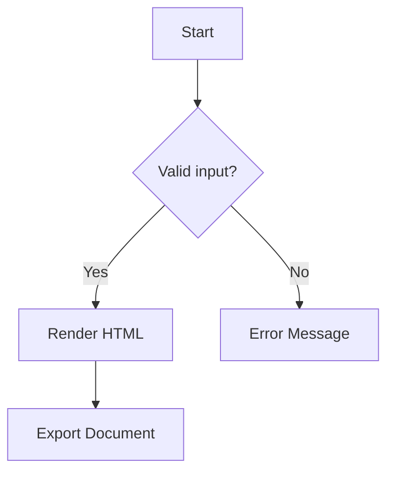
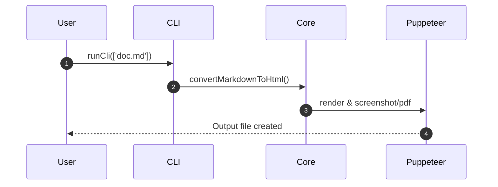
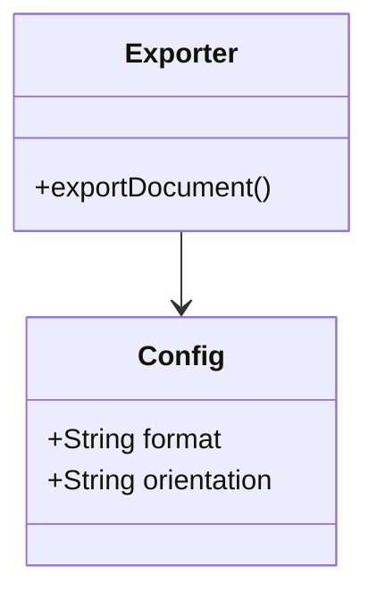
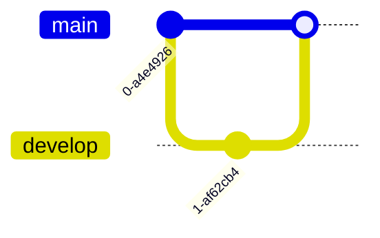
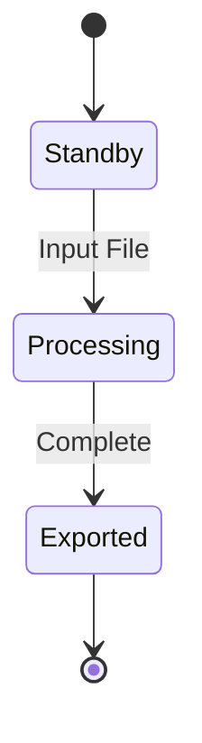

# Feature Showcase for Markdown PDF CLI

This sample showcases all supported formatting, diagrams, and math features converted using the standalone CLI.

## Overview Matrix

| Category | Syntax / Engine | Supported |
| :--- | :--- | :---: |
| Mermaid Diagrams | ```mermaid code blocks (flowchart, sequence, class, gitGraph, state) | Yes |
| KaTeX Mathematics | Inline, block, brackets `\(...\)` / `\[...\]`, and ```math fence | Yes |
| PlantUML Diagrams | Both `@startuml` blocks and ```plantuml code fences | Yes |
| Syntax Highlighting | Highlight.js for TypeScript, Python, JSON, HTML, Bash | Yes |
| Task Lists | Checkboxes `- [x]` and `- [ ]` | Yes |
| Emojis | Shortcodes like `:smile:`, `:tada:`, `:rocket:` | Yes |
| Callout Containers | Container plugin `::: warning` and `::: tip` | Yes |
| Markdown Includes | `:[Include Title](relative-path.md)` | Yes |

## Task List & Emojis

- [x] Core Conversion Engine :tada:
- [x] Puppeteer PDF & Image Exporter :rocket:
- [ ] Explore custom style options :smile:

## Containers

::: tip
Tip: You can convert this file into PDF, HTML, PNG, and JPEG in a single command:
`npx markdown-pdf --type all sample/feature-showcase.md`
:::

::: warning
Warning: Always ensure valid syntax inside Mermaid and PlantUML blocks to avoid rendering issues.
:::

## KaTeX Math

Inline: $E = mc^2$ and $e^{i\pi} + 1 = 0$.

Block display:
$$
\int_{-\infty}^{\infty} e^{-x^2} \, dx = \sqrt{\pi}
$$

LaTeX brackets display:
\[
\sum_{k=1}^{n} k^3 = \left( \frac{n(n+1)}{2} \right)^2
\]

Fenced math code block:
```math
\mathbf{X} = \begin{pmatrix} x_{11} & x_{12} \\ x_{21} & x_{22} \end{pmatrix}
```

## Syntax Highlighting

```typescript
export function convertMarkdown(text: string): string {
  console.log("Converting markdown with syntax highlighting");
  return text.trim();
}
```

```python
def generate_report(items: list[str]) -> None:
    for idx, item in enumerate(items, 1):
        print(f"{idx}: {item}")
```

## PlantUML Diagrams

### Standard Syntax
@startuml
skinparam monochrome true
actor User
participant CLI
User -> CLI: Run conversion
CLI --> User: Generate PDF
@enduml

### Fenced Syntax
```plantuml
Bob -> Alice : Hello
Alice --> Bob : Hi there!
```

## Mermaid Diagrams

### Flowchart


### Sequence Diagram


### Class Diagram


### Git Graph


### State Diagram


## Markdown Include

:[Included Sub-section](feature-showcase-include.md)
