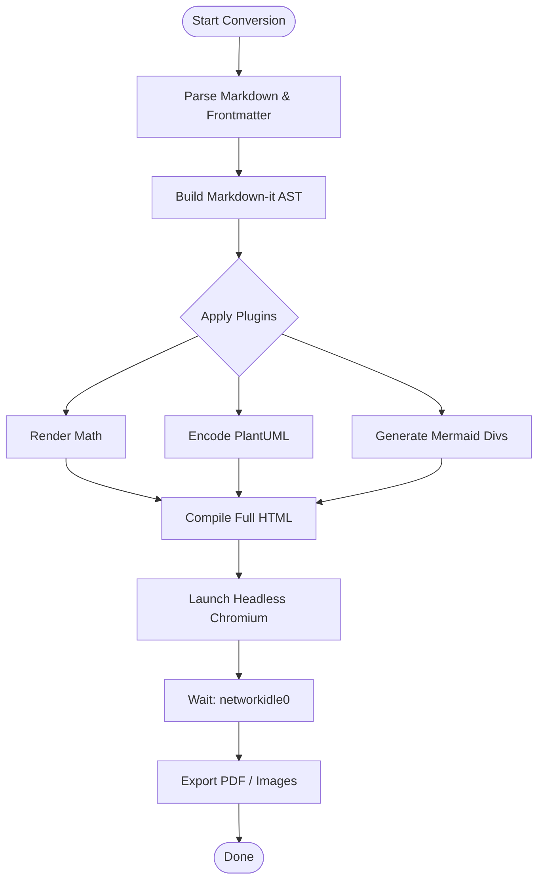
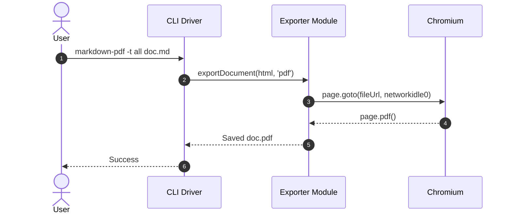
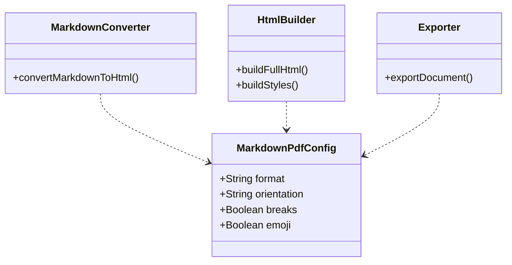
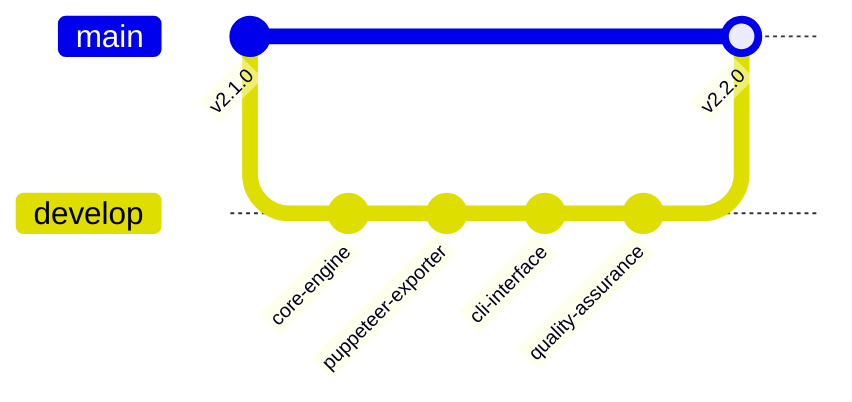
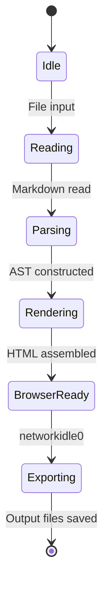

# Comprehensive CLI Parity Showcase

This document exercises all syntax and rendering features supported by the markdown-pdf engine to ensure 100% parity across CLI and Extension environments.

## Features Matrix

| Feature Category | Syntax / Mechanism | Supported |
| :--- | :--- | :---: |
| Mermaid Diagrams | ```mermaid code blocks (flowchart, sequence, class, gitGraph, state) | Yes |
| KaTeX Mathematics | Inline, block, brackets `\(...\)` / `\[...\]`, and ```math fence | Yes |
| PlantUML Diagrams | Both `@startuml` blocks and ```plantuml code fences | Yes |
| Syntax Highlighting | Highlight.js for TypeScript, Python, JSON, HTML, Bash | Yes |
| Task Lists | Checkboxes `- [x]` and `- [ ]` | Yes |
| Emojis | Shortcodes like `:smile:`, `:tada:`, `:rocket:` | Yes |
| Callout Containers | Container plugin `::: warning` and `::: tip` | Yes |
| Markdown Includes | `:[Include Title](relative-path.md)` | Yes |
| Header Slugs | Automatic header slugification and internal anchors | Yes |

## Task List & Emojis

- [x] Implement core converter engine :tada:
- [x] Adapt headless Chromium exporter :rocket:
- [ ] Manual review and visual inspection :smile:

## Callout Containers

::: warning
Warning: Ensure headless browser has proper sandboxing settings for production environments.
:::

::: tip
Tip: You can export to multiple formats simultaneously using `--type all`.
:::

## KaTeX Mathematics

Inline equation: $E = mc^2$ and Euler's identity $e^{i\pi} + 1 = 0$.

Display block:

$$
\int_{-\infty}^{\infty} e^{-x^2} \, dx = \sqrt{\pi}
$$

Inline bracket syntax: \(\alpha + \beta = \gamma\).

Display bracket syntax:

\[
\sum_{k=1}^{n} k^3 = \left( \frac{n(n+1)}{2} \right)^2
\]

Fenced math block:

```math
\mathbf{A} = \begin{pmatrix} a_{11} & a_{12} \\ a_{21} & a_{22} \end{pmatrix}
```

## Syntax Highlighting

### TypeScript
```typescript
export interface ConversionOptions {
  type: ('pdf' | 'html' | 'png' | 'jpeg')[];
  format?: string;
  landscape?: boolean;
}

export function executeCli(args: string[]): number {
  console.log(`Processing ${args.length} arguments.`);
  return 0;
}
```

### Python
```python
def fibonacci(n: int) -> list[int]:
    """Generate Fibonacci sequence up to n terms."""
    seq = [0, 1]
    while len(seq) < n:
        seq.append(seq[-1] + seq[-2])
    return seq[:n]
```

### JSON
```json
{
  "name": "markdown-pdf-cli",
  "version": "2.2.0",
  "features": ["mermaid", "katex", "plantuml", "syntax-highlighting"]
}
```

### HTML
```html
<!DOCTYPE html>
<html lang="en">
  <head><title>Test Page</title></head>
  <body><p>Hello from embedded HTML snippet!</p></body>
</html>
```

### Bash
```bash
#!/usr/bin/env bash
node dist/cli.js --type all --format A4 document.md
```

## PlantUML Diagrams

### PlantUML Standard Syntax
@startuml
skinparam monochrome true
actor Developer
participant "markdown-pdf CLI" as CLI
participant "Puppeteer" as P
Developer -> CLI: Run conversion
CLI -> P: Render HTML & Hydrate
P --> CLI: Return PDF Buffer
CLI --> Developer: File Generated
@enduml

### PlantUML Fenced Syntax
```plantuml
Bob -> Alice : Authentication Request
Alice --> Bob : Authentication Response
```

## Mermaid Diagrams

### 1. Flowchart


### 2. Sequence Diagram


### 3. Class Diagram


### 4. Git Graph


### 5. State Diagram


## Markdown Include

:[Included Sub-section](comprehensive-include-target.md)

## Internal Links Anchor Verification

Return to [Top of Document](#comprehensive-cli-parity-showcase) or check [Features Matrix](#features-matrix).
